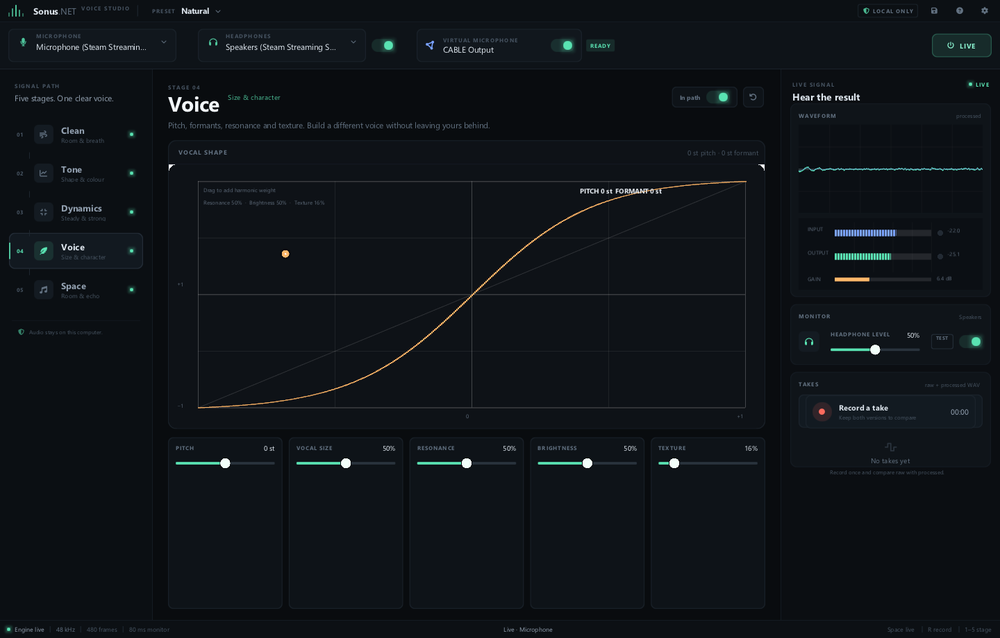
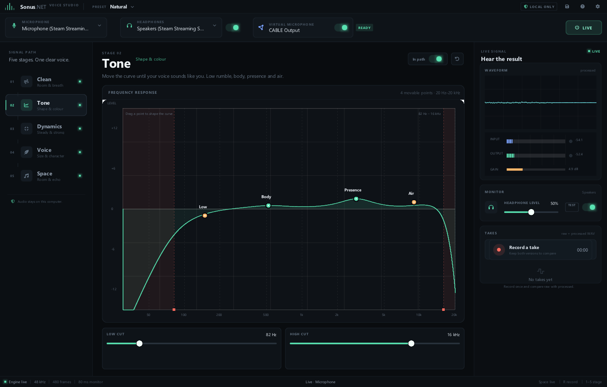
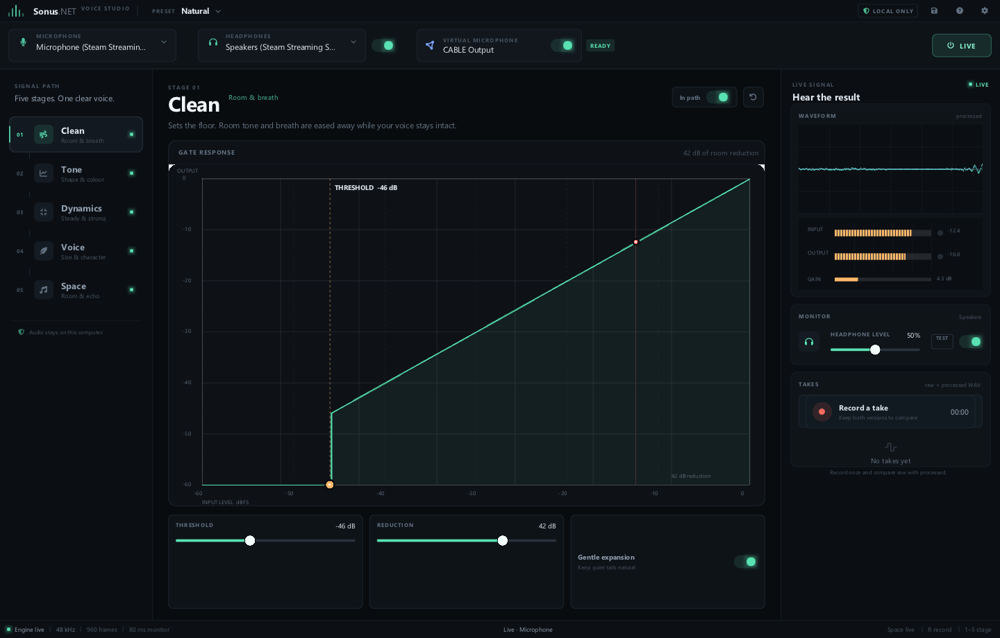
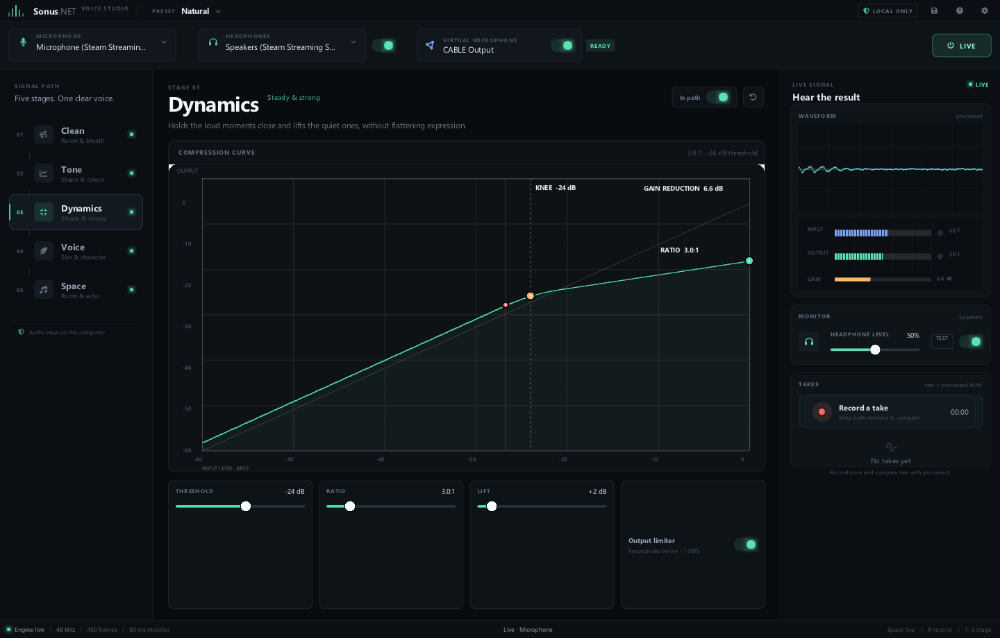
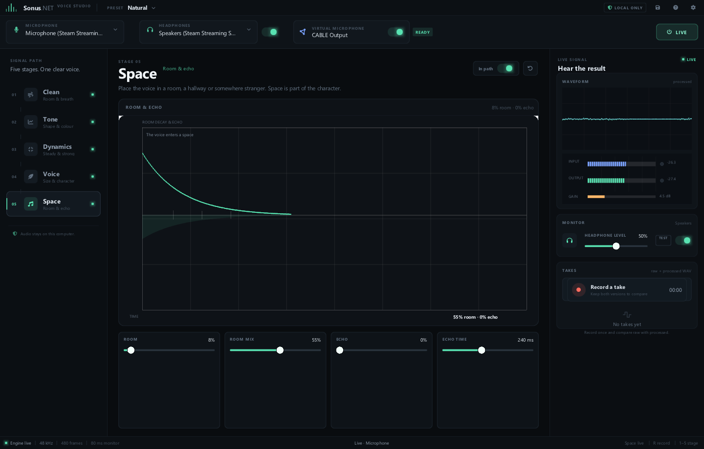
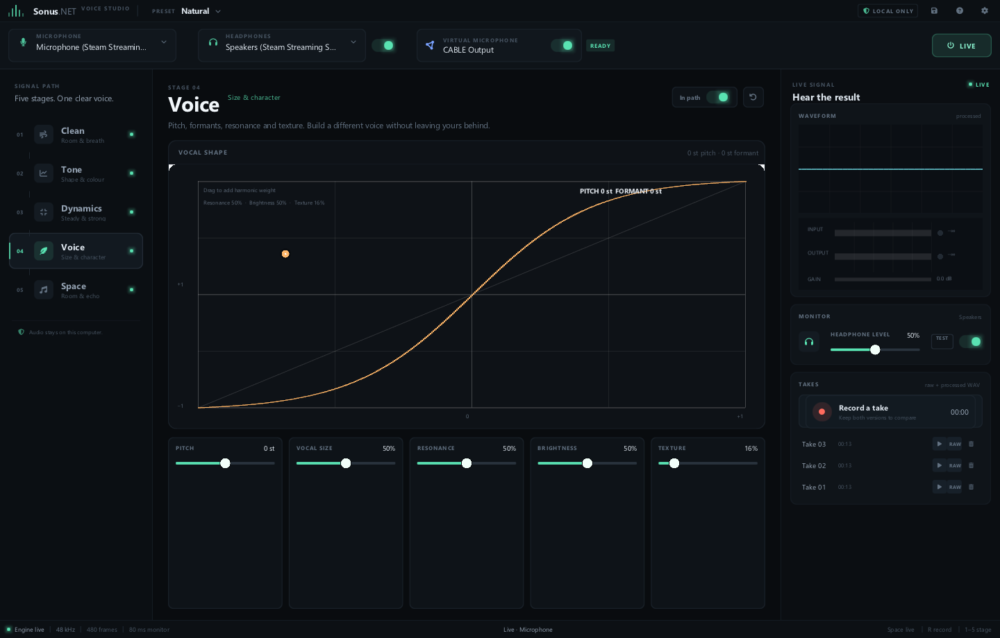
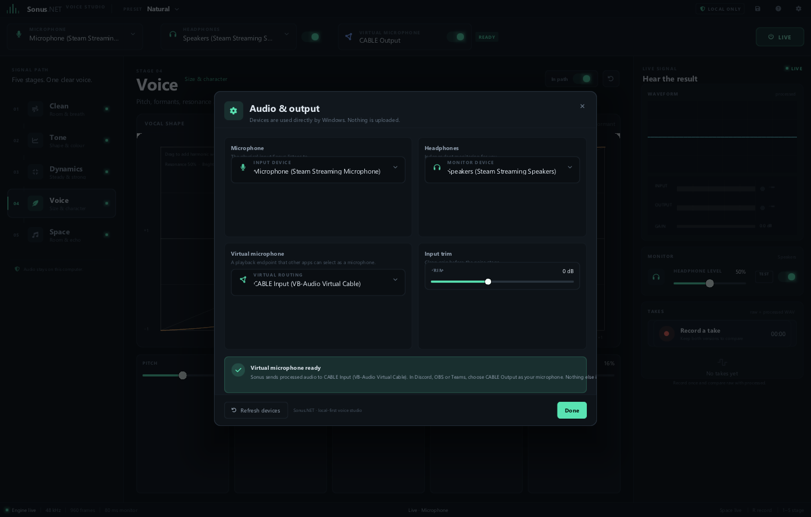
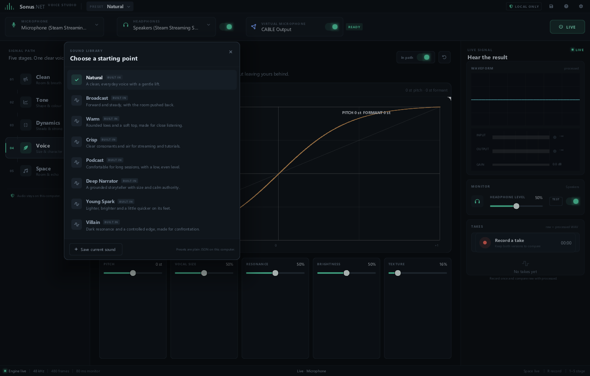

# Sonus.NET

**A local-first voice studio for Windows.** Sonus listens to your microphone, shapes the sound through five visual stages, lets you hear the result in headphones and exposes it as a virtual microphone that Discord, OBS, Teams, games and recording tools can select.

There is no account, cloud processing, subscription or telemetry. Audio stays on the machine.

[](https://github.com/OpenCreativeSuite/SonarDotNet/releases/latest)
[](https://opencreativesuite.github.io/SonarDotNet/)



## A voice studio, not another microphone EQ

Sonus is built around a simple loop: choose a microphone, shape the voice, hear it in headphones, then send it anywhere or record it. The interface stays close to the sound rather than becoming a wall of plugins.

- **Live microphone capture** with device selection, input trim, level metering and clipping hold.
- **Headphone monitoring** with an independent level and a **Test** button, separate from the virtual output.
- **A real virtual microphone** through the signed VB-CABLE driver. Sonus detects it automatically, routes the processed signal to `CABLE Input`, and other applications choose `CABLE Output`.
- **Five visual stages** — Clean, Tone, Dynamics, Voice and Space.
- **An interactive tone curve.** Drag Low, Body, Presence and Air points directly on the frequency graph.
- **A visual compressor curve** with draggable knee and ratio handles, a limiter and live gain-reduction feedback.
- **Voice shaping** with pitch, formant/vocal-size shifting, resonance, brightness and texture.
- **Space** with a short room, room mix and a controlled echo.
- **Raw and processed recording at the same time.** Every take writes two WAV files, and unwanted takes can be discarded from the list.
- **Local presets** in plain JSON, plus device and processing restore at launch.
- **Graceful device failure.** If a microphone disappears, capture stops cleanly and the interface reports it.

## Made for everyday jobs

| I want to… | Sonus.NET can |
| --- | --- |
| Make my microphone sound professional | Use Clean, Tone and Dynamics for a quiet floor, a clear voice and a steady level. |
| Hear myself while I speak | Select headphones, enable monitoring and press **TEST**. |
| Use Sonus in Discord, OBS or Teams | Install VB-CABLE once, enable the virtual microphone, then choose **CABLE Output** in the other app. |
| Make my voice sound bigger or smaller | Move **Vocal size** in the Voice stage. Formants change independently of pitch. |
| Build a character voice | Start from a character preset, then adjust pitch, vocal size, resonance, brightness and texture. |
| Place a voice in a room | Use Room and Echo in the Space stage. |
| Compare clean and processed audio | Record a take and switch between its RAW and PROCESSED versions. |
| Keep a sound for later | Save the current values as a local preset in the sound library. |
| Use the result in another editor | Recordings are ordinary 48 kHz WAV files in `Documents\Sonus Recordings`. |

## A look around

| Tone | Voice |
| --- | --- |
|  |  |
| Drag the points to shape the frequency response. | Pitch changes the note; vocal size changes the formants. |

| Clean | Dynamics |
| --- | --- |
|  |  |
| Set the room floor and how far the gate closes. | Drag the curve to set threshold, ratio and lift. |

| Space | Recording |
| --- | --- |
|  |  |
| Place the voice in a room and add an echo. | Every take keeps the raw microphone and the processed result. |

| Audio settings | Sound library |
| --- | --- |
|  |  |
| Choose devices and set up the virtual microphone. | Start from an enhancement or character preset. |

## The five stages

| Stage | Purpose | What is inside |
| --- | --- | --- |
| **Clean** | Remove unwanted sound | Noise gate, gentle expansion, room floor. |
| **Tone** | Shape frequency and colour | Interactive four-point EQ, low cut, high cut. |
| **Dynamics** | Keep the voice consistent | Compressor, make-up lift, output limiter. |
| **Voice** | Change vocal identity | Pitch, formant/vocal size, resonance, brightness, texture. |
| **Space** | Create an environment | Short room, room mix, echo, echo time. |

Each stage can be bypassed. Monitoring, the virtual microphone and the recorder all consume the same processed signal; they are independent output paths, not separate processing chains.

## Get started in a minute

1. Run Sonus.NET.
2. Choose a microphone and headphones in the top bar.
3. Press **LIVE** and speak. The input and output meters should move.
4. Enable **Monitoring** and press **TEST** to confirm the headphone route.
5. Open **Settings → Virtual microphone → Download & install** once, if VB-CABLE is not already present. Complete the official installer and restart Windows.
6. Enable the **Virtual microphone** switch. In Discord/OBS/Teams, select **CABLE Output (VB-Audio Virtual Cable)**.
7. Shape the sound in Clean, Tone, Dynamics, Voice and Space. Record a take to compare raw and processed versions.

### Why a driver?

Windows does not provide a user-mode API for creating a recording endpoint. Applications cannot invent a microphone that other applications can enumerate. Sonus therefore uses the free, signed **VB-CABLE** virtual audio device and keeps the driver separate from the DSP engine. The app detects the cable, selects its playback side automatically, and the setup sheet offers the official package when it is missing.

VB-CABLE is donationware by [VB-Audio](https://vb-audio.com/Cable/). Sonus does not bundle or modify the driver; the setup sheet downloads the official package and runs the official installer.

## Recording and comparison

Recording writes both versions of every take at once:

```text
Documents\Sonus Recordings\Sonus_YYYY-MM-DD_HH-mm-ss_raw.wav
Documents\Sonus Recordings\Sonus_YYYY-MM-DD_HH-mm-ss_processed.wav
```

Playback uses the selected headphones, so the comparison stays on the device you were monitoring with. Select a take to show the transport, switch between RAW and PROCESSED, or use the trash button to discard both files.

## Build and test

Requires the [.NET 10 SDK](https://dotnet.microsoft.com/download) on Windows.

```sh
dotnet build SonarDotNet.csproj
dotnet run
```

Run the tests with:

```sh
dotnet test tests/SonarDotNet.Tests/SonarDotNet.Tests.csproj
```

The suite covers the gate, EQ response, compressor curve, limiter, pitch shifting, spectral formant shifting, the Voice and Space stages, resampling, device-format conversion, ring buffers, WAV recording, take playback and every major interface component through Donkeh's headless harness. An optional hardware test runs with `SONUS_AUDIO_TEST=1` when VB-CABLE and a loopback-capable input are installed.

The desktop host accepts a headless frame capture:

```sh
dotnet run -- --screenshot frame.bmp
```

## Project layout

```text
Program.cs                       application root, overlays and shortcuts
src/Core/
  VoiceSettings.cs               immutable processing configuration
  StudioSession.cs               devices, presets, recording and view state
  Dsp/                           biquads, gate, compressor, limiter,
                                 pitch/formant, space and tone curves
  Audio/                         WASAPI host, format conversion, resampling,
                                 output sinks, telemetry, WAV recording
src/Components/
  App/App.css                    the complete visual identity
  Chrome/                        top bar, device bar, preset list, menus
  Stages/                        stage rail, editors and interactive graphs
  Live/                          scope, meters, takes and transport
  Dialogs/                       settings, help, save-preset, VB-CABLE setup
tests/SonarDotNet.Tests/         DSP, recording and component tests
docs/                            illustrated user guide and screenshots
.github/workflows/               tests, GitHub Pages and Windows release
```

The DSP engine has no dependency on the interface and can process supplied buffers without audio hardware. The processing chain runs at 48 kHz mono; device formats and sample rates are converted at the boundary. Monitoring and virtual output use independent WASAPI render consumers.

## Free and private

Sonus does not create an account, contact a server for audio processing, or collect usage data. The only network action is the optional VB-CABLE package download from VB-Audio when the user explicitly asks for it. Recordings are written to `Documents\Sonus Recordings`; presets and preferences live under `%LOCALAPPDATA%\Sonus`.

## Learn the app

The illustrated guide lives in [`docs/`](docs/index.html) and is published at:

**https://opencreativesuite.github.io/SonarDotNet/**

- [The five stages](https://opencreativesuite.github.io/SonarDotNet/stages.html) — Clean, Tone, Dynamics, Voice and Space
- [Microphone & virtual output](https://opencreativesuite.github.io/SonarDotNet/microphone.html) — devices, monitoring and VB-CABLE
- [Recording](https://opencreativesuite.github.io/SonarDotNet/recording.html) — takes, comparison and files
- [Shortcuts](https://opencreativesuite.github.io/SonarDotNet/shortcuts.html) — keys and pointer controls

## Project links

- [Latest release](https://github.com/OpenCreativeSuite/SonarDotNet/releases/latest)
- [User guide](https://opencreativesuite.github.io/SonarDotNet/)
- [Documentation source](docs/)
- [GitHub Actions](.github/workflows/) — tests, Pages deployment and Windows release builds
- [Report an issue](https://github.com/OpenCreativeSuite/SonarDotNet/issues)
